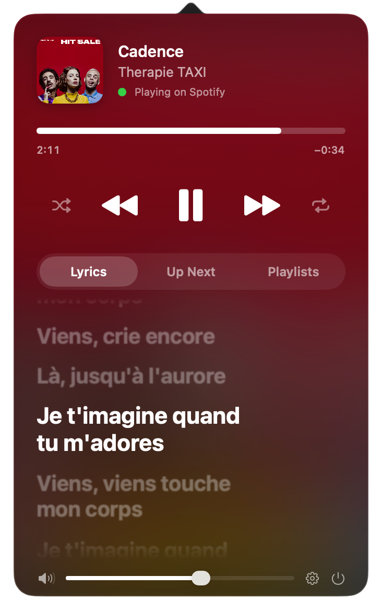
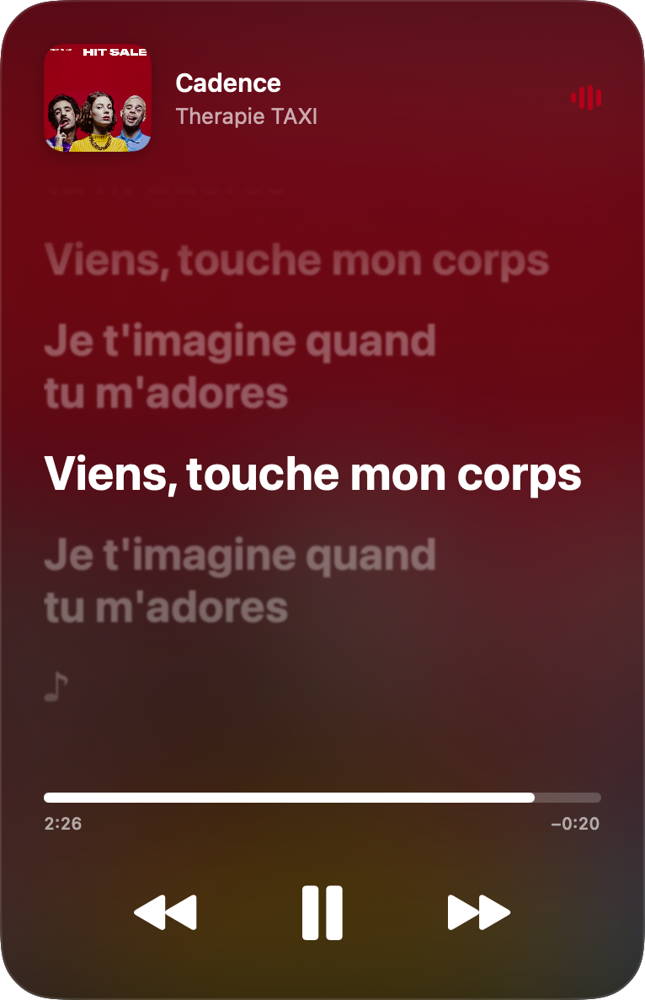

<div align="center">
  
  <br><br>
  <a href="https://github.com/einfach-ioannis/Lyric/releases/latest"></a>
  
  
</div>

<br>

**Lyric** puts synced lyrics and playback controls for **Spotify** and **Apple Music** in your menu bar — and shows a big, beautiful player with live lyrics on your **Lock Screen**.

<p align="center">
  
  &nbsp;&nbsp;
  
</p>

## Features

- 🎤 **Live lyrics** — synced line by line; click a line to jump there.
- 🔒 **Lock Screen player** — artwork, lyrics and controls while your Mac is locked.
- 🎛️ **Menu bar styles** — level meter, title, cover, the line being sung, or inline controls.
- ⏯️ **Full controls** — play, skip, shuffle, repeat, volume and scrubbing.
- 📜 **Up Next & Playlists** — see what’s coming and start any playlist with one click.
- ❤️ **Favorites** — like the current song in Spotify or Apple Music.
- ✨ **Little things** — right-click the menu bar item for quick actions, scroll over it to change volume, copy song or lyrics, ← / → to skip.
- 🌍 **14 languages** — English, German, Spanish, French, Italian, Portuguese (Brazil), Dutch, Polish, Turkish, Greek, Russian, Japanese, Korean and Chinese (Simplified).

## Install

1. Download **Lyric-x.y.z.dmg** from the [latest release](https://github.com/einfach-ioannis/Lyric/releases/latest).
2. Open it and drag **Lyric** into **Applications**.
3. Lyric isn’t notarized, so the first launch is blocked once: open **System Settings → Privacy & Security** and click **Open Anyway**.

A short welcome walks you through permissions and the menu bar style.

**Spotify (optional)** — Up Next, playlists and likes need a free Client ID: Lyric → Settings → Spotify shows the four steps. Lyrics and controls work without it.

## Build from source

Requires macOS 26 and Xcode 26 or later.

```bash
./scripts/build-app.sh --install   # build and copy to /Applications
./scripts/make-dmg.sh              # build the drag-and-drop installer
swift test                         # run the tests
```

## Privacy

No accounts, no analytics. Song title and artist are sent to [LRCLIB](https://lrclib.net) for lyrics (and to the iTunes Search API when a song has no artwork). If you connect Spotify, Lyric talks to Spotify with your own login.

## License

Free for personal and other noncommercial use under the [PolyForm Noncommercial License 1.0.0](LICENSE.md). You may read, change and share the code, but you may not sell Lyric or use it to make money.

Lyrics by [LRCLIB](https://lrclib.net). Lyric is not affiliated with Apple or Spotify.
