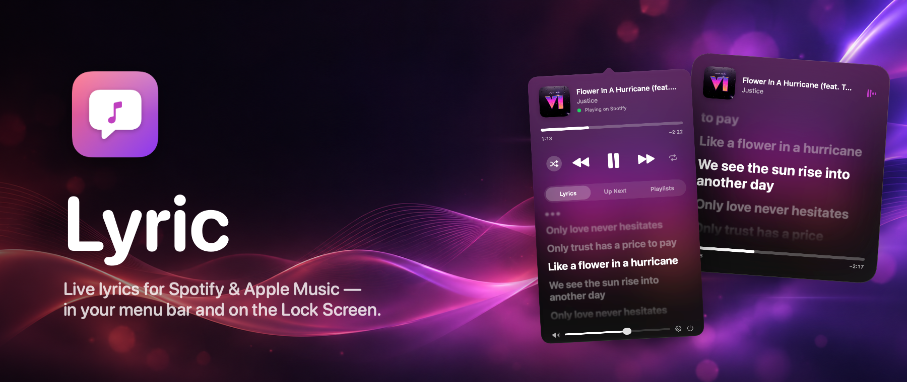
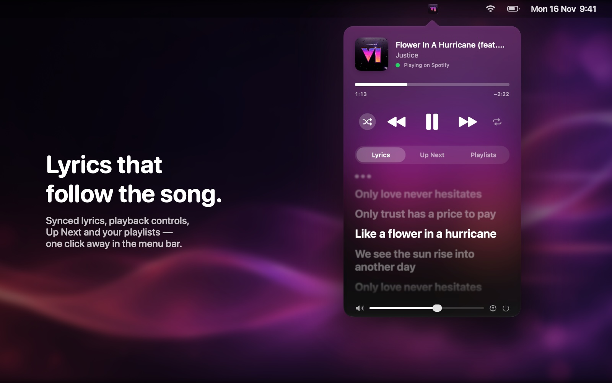
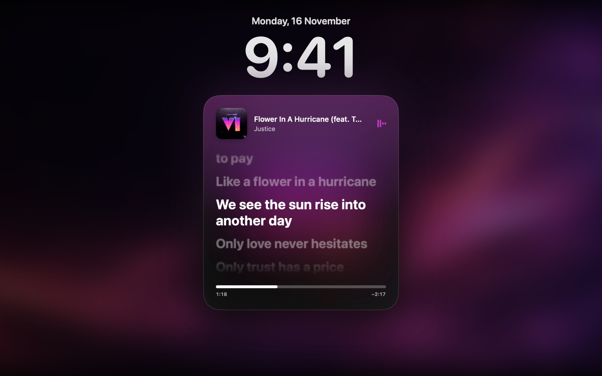
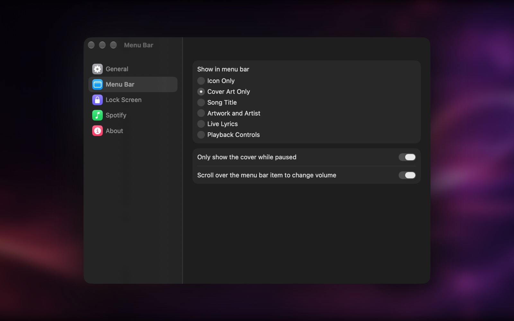

<div align="center">
  

  <h3>Live, synced lyrics for Spotify and Apple Music —<br>right in your menu bar and on your Lock Screen.</h3>

  <a href="https://github.com/einfach-ioannis/Lyric/releases/latest"></a>
  
  
</div>

<br>



<br>

<h2 align="center">Sing along, line by line</h2>

<p align="center">
  The line being sung lights up and stays centred; the rest fade softly away.<br>
  Instrumental parts breathe with <b>• • •</b> until the singing comes back.<br>
  Click any line to jump there — scroll away and <b>Back to Current Line</b> brings you home.
</p>

<br>



<h2 align="center">On your Lock Screen</h2>

<p align="center">
  A calm card with the song and live lyrics while your Mac is locked —<br>
  below the clock or on either side, at the height you like. Or switch it off.
</p>

<br>



<h2 align="center">Make the menu bar yours</h2>

<p align="center">
  Just the icon, the cover art, the song title, the line being sung, or full playback controls.<br>
  Scroll over it to change the volume; right-click for quick actions.
</p>

<br>

## Everything else

<table>
  <tr>
    <td width="50%">⏯️ <b>Full controls</b><br>Play, skip, shuffle, repeat, volume and scrubbing.</td>
    <td width="50%">📜 <b>Up Next &amp; Playlists</b><br>See what's coming and start any playlist in one click.</td>
  </tr>
  <tr>
    <td>❤️ <b>Favorites</b><br>Like the current song in Spotify or Apple Music.</td>
    <td>🎯 <b>Lyrics that line up</b><br>Compares several lyric uploads and fixes lines that are timed wrong.</td>
  </tr>
  <tr>
    <td>⌨️ <b>Little things</b><br>Copy song or lyrics, ← / → to skip, open at login.</td>
    <td>🌍 <b>14 languages</b><br>English, Deutsch, Español, Français, Italiano, Português, Nederlands, Polski, Türkçe, Ελληνικά, Русский, 日本語, 한국어, 简体中文.</td>
  </tr>
</table>

## Install

1. Download **Lyric-x.y.z.dmg** from the [latest release](https://github.com/einfach-ioannis/Lyric/releases/latest).
2. Open it and drag **Lyric** into **Applications**.
3. Lyric isn't notarized, so macOS blocks the first launch once: open **System Settings → Privacy & Security** and click **Open Anyway**.

A short welcome walks you through permissions and the menu bar style.

> [!TIP]
> **Spotify extras are optional.** Up Next, playlists and likes need a free Client ID — *Lyric → Settings → Spotify* shows the four steps. Lyrics and controls work without it.

## Build from source

Requires macOS 26 and Xcode 26 or later.

```bash
./scripts/build-app.sh --install   # build and copy to /Applications
./scripts/make-dmg.sh              # build the drag-and-drop installer
swift test                         # run the tests
```

The README images are rendered from real screenshots with `swift scripts/make-showcase.swift` and `swift scripts/make-banner.swift docs/art/hero-background.png`.

## Privacy

No accounts, no analytics. Song title and artist are sent to [LRCLIB](https://lrclib.net) for lyrics (and to the iTunes Search API when a song has no artwork). If you connect Spotify, Lyric talks to Spotify with your own login.

## License

Free for personal and other noncommercial use under the [PolyForm Noncommercial License 1.0.0](LICENSE.md). You may read, change and share the code, but you may not sell Lyric or use it to make money.

<sub>Lyrics by <a href="https://lrclib.net">LRCLIB</a>. Lyric is not affiliated with Apple or Spotify.</sub>
